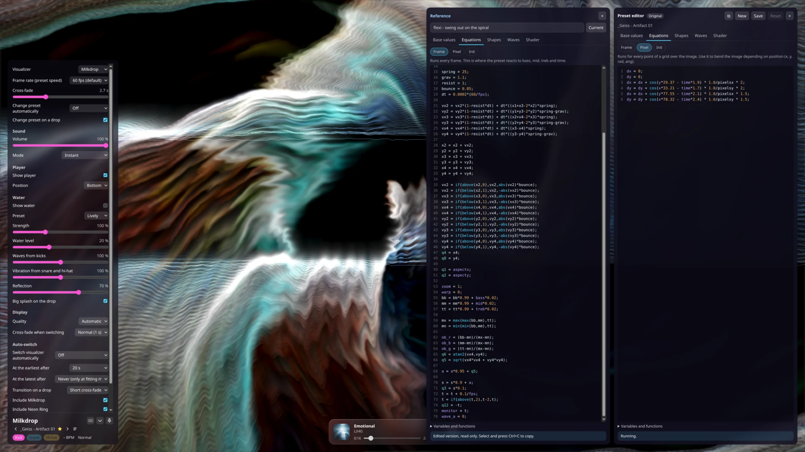

# ButterGlow

ButterGlow turns the music playing in a browser tab into a light show. It is a Chrome extension that captures the
tab's audio, analyses it in real time and drives classic Milkdrop presets and its own visualizers with it, together
with a 10-band equalizer you can actually hear.



## Features

- **Milkdrop presets** – about 490 presets rendered with [Butterchurn](https://github.com/jberg/butterchurn),
  with smooth cross-fades, favourites, collections and automatic switching.
- **Own visualizers** – for example *Neon Ring*, with shockwaves on the kick, sparks on the hi-hat and a big effect
  on the drop, plus several animated water surfaces.
- **Music analysis** – kick, snare and hi-hat detection, tempo (BPM) and song sections (calm, build-up, drop).
- **Equalizer** – 10 bands drawn over the live spectrum, bass boost and presets; settings are remembered.
- **Preset editor** – edit Milkdrop presets live next to the running visualizer, with syntax help and error
  messages, and save them as `.milk` files that MilkDrop 3 and projectM can read as well.
- **Media player** – play, pause and skip the tab you are listening to without leaving the visualizer.
- **Quality levels** – runs on weaker graphics cards, with a debug view for frame times.

The user interface is available in English and German. It follows the browser language; you can change it in the menu
under **Language**.

## Installation

ButterGlow is not in the Chrome Web Store yet. It is installed as an unpacked extension.

### From a release

1. Download `butterglow-<version>.zip` from the [latest release](https://github.com/RichtigerBot/butterglow/releases/latest)
   and extract it into a folder you keep (Chrome loads the extension from there). Not "Source code": that is the
   unbuilt project and does not run as an extension.
2. Open `chrome://extensions` and switch on **Developer mode**.
3. Click **Load unpacked** and choose the extracted folder.
4. Play music in any tab and click the ButterGlow icon in the toolbar.

To update, extract the new release into the same folder and click the reload button on ButterGlow's card in
`chrome://extensions`. Settings, favourites and collections are kept as long as the folder stays the same.

### From source

```bash
git clone https://github.com/RichtigerBot/butterglow.git
cd butterglow
npm install
npm run build
```

Then load the `dist/` folder as described above. `npm run package` additionally packs it into
`release/butterglow-<version>.zip`.

Requires Chrome 124 or newer. Other Chromium browsers work too; in Brave, custom presets are stored inside the
extension because Brave does not allow extensions to access folders.

## Keyboard shortcuts

| Key | Action |
|---|---|
| `V` | Next visualizer |
| `←` `→` | Previous / next preset |
| `B` | Preset browser |
| `M` | Preset editor |
| `N` | Second preset for reference |
| `Space` | Play / pause |
| `E` | Equalizer |
| `F` | Full screen |
| `D` | Debug view |
| `Alt` | Hide the overlay |

## Development

```bash
npm run build      # build the extension into dist/
npm test           # unit tests, then browser tests (needs Chrome, see CONTRIBUTING.md)
npm run previews   # render the small preset previews
```

See [CONTRIBUTING.md](CONTRIBUTING.md) for the project layout and how to run the browser tests.
More documentation:

- [Preset editor](docs/preset-editor.md)
- [Custom presets](docs/custom-presets.md)
- [Debug view and quality levels](docs/debug.md)

## License

ButterGlow is released under the [MIT License](LICENSE).
It bundles third-party software and Milkdrop presets by many authors; see
[THIRD-PARTY-LICENSES.txt](THIRD-PARTY-LICENSES.txt).
